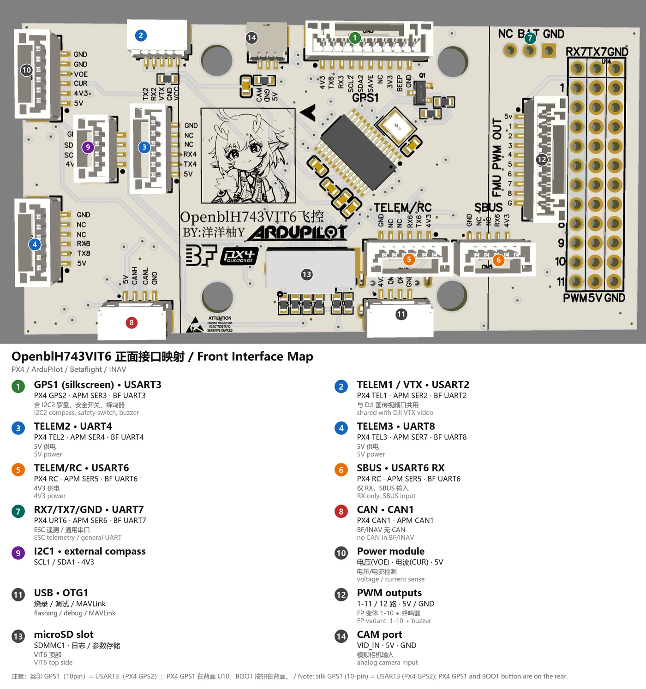
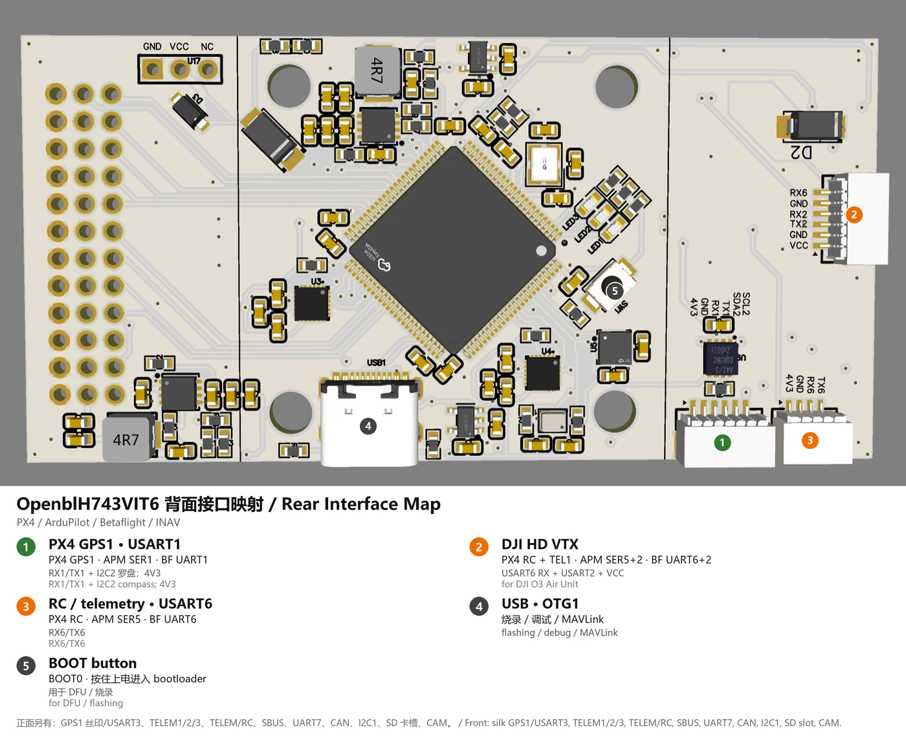
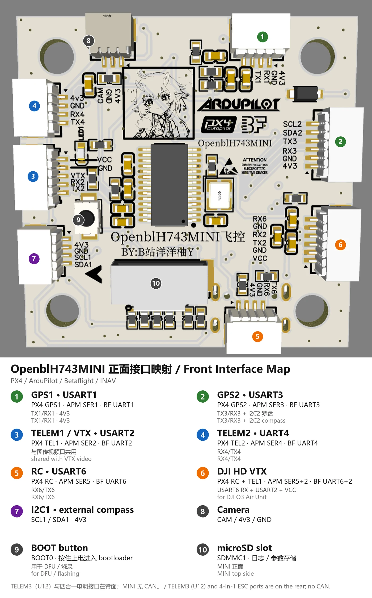
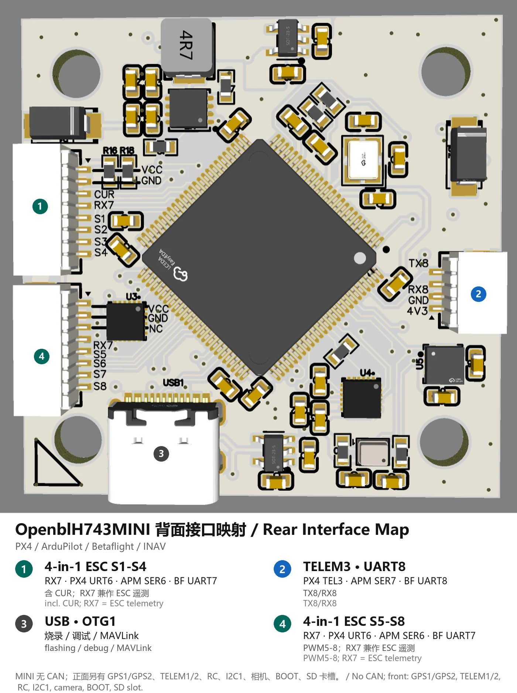

# OpenblH743VIT6 — STM32H743 Flight Controller

Custom **STM32H743VIT6** flight controller (Board ID 18848) supporting PX4, ArduPilot,
Betaflight and INAV. The repository contains the hardware design (schematics, PCB,
BOM, Gerber), mechanical models, parameter sets and prebuilt firmware.

The hardware design is also published on **OSHWHub** (立创开源硬件平台):
[OpenblH743VIT6 flight controller](https://oshwhub.com/yangyangyou/project_nuqtfxty).

[中文说明](README_zh.md)

## Interface map

| VIT6 front | VIT6 rear |
|---|---|
| [](PPT/annotated/H743VIT6_top_annotated.png) | [](PPT/annotated/H743VIT6_back_annotated.png) |
| **MINI front** | **MINI rear** |
| [](PPT/annotated/H743MINI_top_annotated.png) | [](PPT/annotated/H743MINI_back_annotated.png) |

Click an image for full resolution. Connector-to-UART tables:
[interface_map_en.md](PPT/interface_map_en.md) · [接口说明](PPT/interface_map_zh.md).

## Highlights

- STM32H743VIT6, **Board ID 18848**, shares the **APM bootloader** (no proprietary bootloader required)
- Two onboard MPU6500 IMUs; each of the three IMU chip-select positions (PB12 / PD7 / PD5)
  also accepts an **ICM-42605** or **ICM-42688-P**
- SPL06 barometer, QMC5883P compass, AT7456E OSD, microSD, CAN/UAVCAN, USB
- DShot + ESC telemetry, optional INA238 power monitor
- PX4 firmware with fixed-wing/VTOL support, status LEDs and full serial mapping
- Prebuilt firmware for PX4, ArduPilot (Copter/Plane), Betaflight and INAV

## Hardware

| Item | Detail |
|---|---|
| MCU | STM32H743VIT6 (Cortex-M7), Board ID 18848 |
| IMU0 / IMU1 | 2× MPU6500 (SPI2 CS PB12 / SPI3 CS PD7); both positions also accept ICM-42605 / ICM-42688-P |
| Optional IMU2 | SPI3 CS PD5 — MPU6500 or ICM-42605 / ICM-42688-P |
| Barometer | SPL06 (I2C, 0x76/0x77 auto-scan) |
| Compass | QMC5883P (I2C1, 0x2C) + external compass support |
| OSD | AT7456E (SPI1, CS PC4) |
| Storage | microSD (SDMMC1) |
| CAN | UAVCAN / DroneCAN on PB8 (RX) / PB9 (TX) |
| RC input | USART6 (PX4 `ttyS5`) |
| GPS | USART1 (GPS1), USART3 (GPS2) |
| Telemetry | USART2 (TEL1), UART4 (TEL2), UART8 (TEL3), UART7 (URT6) |
| PWM | 12 outputs (10 on the flash-parameter variant; PB0 becomes a passive buzzer) |
| Battery | PC0 (voltage) / PC1 (current) ADC; INA238 optional |
| Safety switch | PB2 |

Hardware design files cover the **VIT6** and **MINI** boards; the firmware board ports and
prebuilt targets in this repository are named for the VIT6. The complete **LCEDA Pro**
engineering project (VIT6 + MINI) is included as
`Circuit_diagram电路图/ProPrj_OpenblH743飞控板星火计划_2026-11-04.epro2` and opens in
立创EDA专业版. The hardware design is published on
[OSHWHub](https://oshwhub.com/yangyangyou/project_nuqtfxty) with an online schematic/PCB viewer.

## Firmware

| Family | Version | Targets | Notes |
|---|---|---|---|
| PX4 | v1.17.0-alpha1 | `openbl_h743_default`, `openbl_h743_dds`, `openbl_h743fp_default`, `openbl_h743fp_dds` | `default` = CAN/UAVCAN, `dds` = uXRCE-DDS; `h743` = parameters on SD card, `h743fp` = parameters in internal flash |
| ArduPilot | Copter 4.7.1 / Plane 4.7.1 | `arducopter`, `arduplane`, bootloader | board hwdef under `firmware固件/src编译源代码资料/APM/` |
| Betaflight | 4.5.3 | single target | configuration under `firmware固件/src编译源代码资料/Betafight/` |
| INAV | 9.0.1 | single target | configuration under `firmware固件/src编译源代码资料/INAV/` |

Prebuilt firmware is in [`firmware固件/built已编译固件/`](firmware固件/built已编译固件/).
PX4 merged hex files include the bootloader and are flashed with ST-Link; `.px4` files can be
flashed from QGC.

> **Bootloader note**: PX4 and ArduPilot use the shared APM bootloader. The Betaflight and INAV
> targets are linked for direct flashing from `0x08000000` and **do not preserve the APM
> bootloader** — reflash the bootloader when switching back to PX4/ArduPilot.

## Repository layout

| Path | Description |
|---|---|
| [`Circuit_diagram电路图/`](Circuit_diagram电路图/) | Schematics (PDF), PCB Gerber, BOM, pick-and-place and the LCEDA Pro project (VIT6 and MINI) |
| [`STL图纸/`](STL图纸/) | 3D mechanical models and solder-paste stencils |
| [`firmware固件/built已编译固件/`](firmware固件/built已编译固件/) | Prebuilt PX4 / ArduPilot / Betaflight / INAV firmware |
| [`firmware固件/src编译源代码资料/`](firmware固件/src编译源代码资料/) | PX4 board sources, ArduPilot hwdef, Betaflight/INAV configs, build notes |
| [`param参数/`](param参数/) | SD-card parameter package for the INA238 (DPM238) power monitor |
| [`PPT/`](PPT/) | Interface mapping documents and annotated board images |
| `LICENSE`, `LICENSE-HARDWARE`, `NOTICE.md` | Licenses and third-party notices |

## Documentation

| Document | English | 中文 |
|---|---|---|
| PX4 board (SD-card parameters) | [`readme.md`](firmware固件/src编译源代码资料/PX4/openblh743/readme.md) | [`readme_zh.md`](firmware固件/src编译源代码资料/PX4/openblh743/readme_zh.md) |
| PX4 flash-parameter variant | [`readme.md`](firmware固件/src编译源代码资料/PX4/openblh743fp/readme.md) | [`readme_zh.md`](firmware固件/src编译源代码资料/PX4/openblh743fp/readme_zh.md) |
| GPIO / pin reference | [`gpio.md`](firmware固件/src编译源代码资料/PX4/openblh743/gpio.md) | [`gpio_zh.md`](firmware固件/src编译源代码资料/PX4/openblh743/gpio_zh.md) |
| ArduPilot port | [`readme.md`](firmware固件/src编译源代码资料/APM/readme.md) | [`readme_zh.md`](firmware固件/src编译源代码资料/APM/readme_zh.md) |
| Betaflight target (VIT6) | [`README.md`](firmware固件/src编译源代码资料/Betafight/OpenblH743VIT6/README.md) | [`README_zh.md`](firmware固件/src编译源代码资料/Betafight/OpenblH743VIT6/README_zh.md) |
| Betaflight build notes | [`how_to_build_en.txt`](firmware固件/src编译源代码资料/Betafight/how_to_build_en.txt) | [`编译方法.txt`](firmware固件/src编译源代码资料/Betafight/编译方法.txt) |
| INAV target (VIT6) | [`README_en.md`](firmware固件/src编译源代码资料/INAV/OpenblH743VIT6/README_en.md) | [`README.md`](firmware固件/src编译源代码资料/INAV/OpenblH743VIT6/README.md) |
| INAV build notes | [`how_to_build_en.txt`](firmware固件/src编译源代码资料/INAV/how_to_build_en.txt) | [`编译方法.txt`](firmware固件/src编译源代码资料/INAV/编译方法.txt) |
| INA238 / DPM238 setup | [`INSTRUCTIONS_EN.txt`](param参数/OpenblH743_DPM238_SD_px4/INSTRUCTIONS_EN.txt) | [`使用说明.txt`](param参数/OpenblH743_DPM238_SD_px4/使用说明.txt) |
| Interface map (VIT6 / MINI) | [`interface_map_en.md`](PPT/interface_map_en.md) | [`interface_map_zh.md`](PPT/interface_map_zh.md) |

## Building from source

**PX4** — use the PX4 Autopilot tree, copy `boards/openbl/h743` and `boards/openbl/h743fp`
from this repository into `boards/openbl/`, and build with GCC 10.2.1
(`arm-none-eabi-10-2020-q4-major`); GCC 13.x produces non-bootable H7 code.

```bash
make openbl_h743_default
make openbl_h743_dds
make openbl_h743fp_default
make openbl_h743fp_dds
```

The PX4 board readmes document the trim set, flash budget, local patches to PX4 shared code
(`shared_src/`) and the merged-hex step.

**ArduPilot**

```bash
./waf configure --board OpenblH743VIT6
./waf copter     # or: ./waf plane
```

See the ArduPilot readme for the bootloader build and output files.

**Betaflight / INAV** — see the build notes in the respective source folders.

## Notes and limitations

- **Parameter storage**: `openbl_h743_*` keeps parameters on the SD card; `openbl_h743fp_*`
  stores them in the last 128 KB flash sector and works without an SD card
  (flight logs still require the SD card).
- **Airspeed**: the reference tailsitter has no airspeed sensor; the VTOL front transition
  completes on attitude/time and TECS runs without airspeed. Add a pitot before fixed-wing flight.
- **Precision landing**: the landing-target estimator is retained for future use with a
  companion computer (MAVLink `LANDING_TARGET`) or an IRLock; no target source is included.
- **SPI2** runs in polling mode on this board revision (DMA stream conflict); SPI3 uses DMA.
- **ICM-42605 driver compatibility**: the local patch also accepts the ICM-42688-P
  (WHO_AM_I `0x47`) and runs it in ICM-42605 compatibility mode (16-bit FIFO,
  reset-default filters). Verify sensor data on the bench before flight.

## License

This repository mixes original work and third-party material; see
[`NOTICE.md`](NOTICE.md) for the full statement.

- **Original work** — hardware design files, mechanical models, parameter sets and original
  firmware code: **CC BY-NC-SA 4.0** (Attribution-NonCommercial-ShareAlike), see
  [`LICENSE`](LICENSE) and [`LICENSE-HARDWARE`](LICENSE-HARDWARE). Commercial use requires
  prior written permission from the author.
- **PX4-derived** firmware and source: **BSD-3-Clause** (© PX4 Development Team).
- **ArduPilot / Betaflight / INAV-derived** material: **GPL-3.0**, under their respective
  original licenses.
- Third-party files keep their original copyright headers and licenses.

## Author

**洋洋柚**

- Gitee: [@zhangyangyangyou](https://gitee.com/zhangyangyangyou)
- GitHub: [@YangYangyou-Zhang](https://github.com/YangYangyou-Zhang)
- OSHWHub: [OpenblH743VIT6](https://oshwhub.com/yangyangyou/project_nuqtfxty)
- Bilibili / Douyin: 洋洋柚Y

Contact details and the authoritative license/attribution statement are maintained in
[`NOTICE.md`](NOTICE.md).

